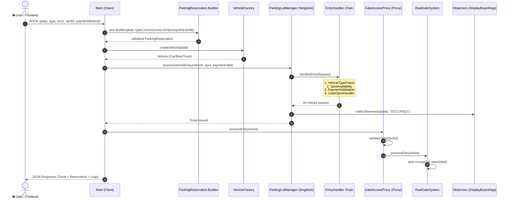
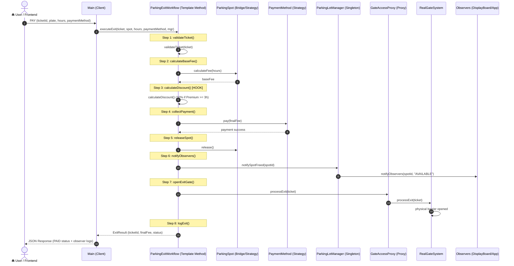

# 📐 UML Diagram Generation Prompts & Diagram Specifications

> **Target Codebase:** Smart Parking Management System (Java 21)  
> **Updated with:** Factory Method, Abstract Factory, Singleton, Builder, Bridge, Proxy, Chain of Responsibility, Observer, Strategy, and Template Method patterns.  
> **Compatible Tools:** PlantUML, Mermaid.js, PlantText, draw.io, ChatGPT, Claude, Gemini, DeepSeek.

---

## 📋 Table of Contents
1. [Prompt 1: Master Class Diagram Generation Prompt (For AI Tools)](#-1-master-class-diagram-generation-prompt)
2. [Prompt 2: Sequence Diagram Prompt (Vehicle Entry & Exit Flows)](#-2-sequence-diagram-generation-prompt)
3. [Pre-Generated Mermaid.js UML Class Diagram](#-3-pre-generated-mermaidjs-uml-class-diagram)
4. [Pre-Generated PlantUML Source Code](#-4-pre-generated-plantuml-source-code)
5. [Pre-Generated Mermaid Sequence Diagrams](#-5-pre-generated-mermaid-sequence-diagrams)

---

## 🤖 1. Master Class Diagram Generation Prompt

> **Instructions:** Copy and paste the prompt below into ChatGPT, Claude, Gemini, or any AI tool to generate updated UML diagrams in whatever format you need (PlantUML, Mermaid, draw.io XML, or Graphviz).

```text
You are an expert software architect and UML modeler. Please generate a comprehensive UML Class Diagram for the following updated Java Smart Parking Management System codebase.

The system demonstrates 9 Object-Oriented Design Patterns:
1. SINGLETON:
   - com.parking.singleton.ParkingLotManager (synchronized getInstance(), holds spots, observers, entryChain, spotDAO)
   - com.parking.database.DatabaseConnection (volatile double-checked locking getInstance())
   - com.parking.client.BookingSession (eager singleton)

2. FACTORY METHOD:
   - abstract class com.parking.factory.VehicleFactory { +createVehicle(plate: String): Vehicle }
   - Concrete factories: CarFactory, BikeFactory, TruckFactory
   - Product hierarchy: abstract class Vehicle { licensePlate: String, +getType(): String, +getSize(): int }
     Subclasses: Car (size=2), Bike (size=1), Truck (size=3)

3. ABSTRACT FACTORY:
   - abstract class com.parking.abstractfactory.ParkingSpotFactory { +createSmallSpot(id), +createMediumSpot(id), +createLargeSpot(id) }
   - Concrete factories: PremiumZoneFactory (binds FlatRatePricing), RegularZoneFactory (binds HourlyPricing)
   - Products: abstract class ParkingSpot { spotId, isOccupied, zone, pricingMode, +calculateFee(hrs), +occupy(), +release() }
     Subclasses: SmallSpot, MediumSpot, LargeSpot, EVChargingSpot

4. BUILDER PATTERN:
   - com.parking.builder.ParkingReservation (immutable, private constructor, mandatory: plate, vehicleType; optional: zone, spotId, spotType, paymentMethod, promoCode, preBookedHours, requiresEVCharging, requiresValet, reservationTime)
   - static nested class ParkingReservation.Builder (fluent setters: inZone(), forSpot(), withPaymentMethod(), withPromoCode(), withPreBookedHours(), withEVCharging(), withValet(), +build(): ParkingReservation with validation)
   - com.parking.builder.ReservationDirector (+constructVIPReservation(), +constructEVReservation(), +constructStandardReservation())

5. BRIDGE PATTERN:
   - Abstraction: ParkingSpot has-a PricingStrategy
   - Implementor: interface com.parking.bridge.PricingStrategy { +calcPrice(hrs: int): double }
   - Concrete Implementations: FlatRatePricing, HourlyPricing, DynamicPricing (with surge multiplier)

6. CHAIN OF RESPONSIBILITY:
   - Handler base: abstract class com.parking.chain.EntryHandler { -next: EntryHandler, +setNext(h), +handle(req), #passToNext(req) }
   - Concrete handlers: VehicleTypeCheckHandler -> SpotAvailabilityHandler -> PaymentValidationHandler -> GateOpenHandler
   - Request model: com.parking.chain.EntryRequest (vehicle, spot, paymentMethodValid)

7. OBSERVER PATTERN:
   - Subject: ParkingLotManager (+registerObserver(o), +notifyObservers(spotId, status), +notifySpotFreed(spotId))
   - Observer interface: interface com.parking.observer.ParkingObserver { +update(spotId: String, status: String): void }
   - Concrete observers: DisplayBoard, MobileAppNotifier

8. PROXY PATTERN:
   - Service interface: interface com.parking.proxy.GateSystem { +processEntry(t: Ticket), +processExit(t: Ticket) }
   - Real Subject: com.parking.proxy.RealGateSystem (has-a PaymentMethod, ParkingSpot)
   - Proxy: com.parking.proxy.GateAccessProxy (validates ticket before delegating to RealGateSystem)

9. STRATEGY PATTERN:
   - Pricing Strategy: PricingStrategy (FlatRatePricing, HourlyPricing, DynamicPricing)
   - Payment Strategy: interface com.parking.payment.PaymentMethod { +pay(amount: double): boolean }
     Concrete strategies: CashPayment, CardPayment, UPIPayment

10. TEMPLATE METHOD PATTERN:
    - Abstract base: abstract class com.parking.template.ParkingExitWorkflow
      + executeExit(ticket, spot, hours, paymentMethod, mgr): ExitResult [FINAL TEMPLATE METHOD]
      # validateTicket(ticket)
      # collectPayment(ticket, paymentMethod, fee, spot)
      # releaseSpot(spot)
      # notifyObservers(mgr, spotId)
      # openExitGate(ticket, paymentMethod, spot)
      # calculateDiscount(ticket, spot, hours, baseFee): double [HOOK METHOD]
      # logExit(ticket, fee) [HOOK METHOD]
    - Concrete subclasses:
      - RegularExitWorkflow (standard exit, 0 discount)
      - PremiumZoneExitWorkflow (overrides calculateDiscount hook for 10% loyalty discount when hours >= 3)
    - Output model: com.parking.template.ExitResult (ticketId, baseFee, discount, finalFee, status)

11. DATA ACCESS & CLIENT:
    - SpotDAO, VehicleDAO, TicketDAO (JDBC access to MySQL)
    - Ticket (entity holding ticketId, plate, spotId, fee, isPaid, times)
    - Main (CLI dispatcher parsing QUERY_SPOTS, BOOK, EXIT, PAY commands)

REQUIREMENTS:
1. Group classes logically into packages using packages or namespaces.
2. Use standard UML notations:
   - Generalization / Inheritance: solid line with hollow arrow (--|>)
   - Realization / Interface Implementation: dashed line with hollow arrow (..|>)
   - Composition: solid line with filled diamond (*--)
   - Aggregation: solid line with open diamond (o--)
   - Dependency / Association: solid or dashed line with arrow (--> or ..>)
3. Explicitly annotate design pattern roles (e.g., <<Singleton>>, <<Template Method>>, <<Strategy>>, <<Builder>>, <<Abstract Factory>>).
4. Provide the output in PlantUML format AND Mermaid.js format.
```

---

## 🔄 2. Sequence Diagram Generation Prompt

> **Instructions:** Use this prompt to generate sequence diagrams showing the interaction between the patterns during vehicle booking and vehicle exit.

```text
Please generate two UML Sequence Diagrams for the Smart Parking Management System:

DIAGRAM 1: Vehicle Entry & Booking Flow
Show the complete interaction between:
Actor (User/API) -> Main -> ReservationDirector / ParkingReservation.Builder -> VehicleFactory -> ParkingLotManager -> EntryHandler chain (VehicleTypeCheckHandler -> SpotAvailabilityHandler -> PaymentValidationHandler -> GateOpenHandler) -> SpotDAO / TicketDAO -> GateAccessProxy -> RealGateSystem -> ParkingLotManager.notifyObservers -> DisplayBoard / MobileAppNotifier.

DIAGRAM 2: Vehicle Exit & Payment Flow (Template Method Pattern)
Show the execution of the Template Method pattern:
Actor (User/API) -> Main -> ParkingExitWorkflow (PremiumZoneExitWorkflow / RegularExitWorkflow) -> ParkingSpot.calculateFee (Bridge/Strategy) -> calculateDiscount hook -> PaymentMethod.pay (Strategy) -> ParkingSpot.release -> ParkingLotManager.notifySpotFreed -> Observers -> GateAccessProxy.processExit -> RealGateSystem -> TicketDAO.updatePaymentStatus -> ExitResult returned to Actor.

Format the sequence diagrams in both PlantUML and Mermaid.js syntax.
```

---

## 📊 3. Pre-Generated Mermaid.js UML Class Diagram

You can preview this diagram in any Markdown viewer (GitHub, VS Code, Notion) or copy it into [Mermaid Live Editor](https://mermaid.live/):

```mermaid
classDiagram
    direction TB

    %% ==========================================
    %% 1. SINGLETON PATTERN
    %% ==========================================
    class ParkingLotManager {
        <<Singleton>>
        -static ParkingLotManager instance
        -List~ParkingObserver~ observers
        -List~ParkingSpot~ spots
        -EntryHandler entryChain
        -SpotDAO spotDAO
        -ParkingLotManager()
        +static getInstance() ParkingLotManager
        +registerObserver(o: ParkingObserver)
        +notifyObservers(spotId: String, status: String)
        +notifySpotFreed(spotId: String)
        +processVehicleEntry(v: Vehicle, s: ParkingSpot, paymentValid: boolean) Ticket
    }

    class DatabaseConnection {
        <<Singleton>>
        -static volatile DatabaseConnection instance
        -DatabaseConnection()
        +static getInstance() DatabaseConnection
        +getConnection() Connection
    }

    %% ==========================================
    %% 2. VEHICLE FACTORY METHOD
    %% ==========================================
    class Vehicle {
        <<Abstract>>
        -String licensePlate
        +getLicensePlate() String
        +getType()* String
        +getSize()* int
    }
    class Car { +getType() String; +getSize() int }
    class Bike { +getType() String; +getSize() int }
    class Truck { +getType() String; +getSize() int }
    Vehicle <|-- Car
    Vehicle <|-- Bike
    Vehicle <|-- Truck

    class VehicleFactory {
        <<Factory Method>>
        +createVehicle(plate: String)* Vehicle
    }
    class CarFactory { +createVehicle(plate: String) Vehicle }
    class BikeFactory { +createVehicle(plate: String) Vehicle }
    class TruckFactory { +createVehicle(plate: String) Vehicle }
    VehicleFactory <|-- CarFactory
    VehicleFactory <|-- BikeFactory
    VehicleFactory <|-- TruckFactory
    VehicleFactory ..> Vehicle : creates

    %% ==========================================
    %% 3. BUILDER PATTERN
    %% ==========================================
    class ParkingReservation {
        <<Product>>
        -String licensePlate
        -String vehicleType
        -String zone
        -String spotId
        -String promoCode
        -int preBookedHours
        -boolean requiresEVCharging
        -boolean requiresValet
        -ParkingReservation(builder: Builder)
        +toJson() String
    }
    class ReservationBuilder {
        <<Builder>>
        +inZone(zone: String) Builder
        +forSpot(id: String, type: String) Builder
        +withPaymentMethod(pm: String) Builder
        +withPromoCode(promo: String) Builder
        +withPreBookedHours(h: int) Builder
        +withEVCharging(ev: boolean) Builder
        +withValet(v: boolean) Builder
        +build() ParkingReservation
    }
    class ReservationDirector {
        <<Director>>
        +static constructVIPReservation(plate, type, spotId) ParkingReservation
        +static constructEVReservation(plate, spotId) ParkingReservation
        +static constructStandardReservation(plate, type, spotId, spotType) ParkingReservation
    }
    ParkingReservation *-- ReservationBuilder : creates
    ReservationDirector ..> ReservationBuilder : directs

    %% ==========================================
    %% 4. ABSTRACT FACTORY & BRIDGE PATTERN
    %% ==========================================
    class ParkingSpotFactory {
        <<Abstract Factory>>
        +createSmallSpot(spotId: String)* ParkingSpot
        +createMediumSpot(spotId: String)* ParkingSpot
        +createLargeSpot(spotId: String)* ParkingSpot
    }
    class PremiumZoneFactory {
        +createSmallSpot(spotId: String) ParkingSpot
        +createMediumSpot(spotId: String) ParkingSpot
        +createLargeSpot(spotId: String) ParkingSpot
    }
    class RegularZoneFactory {
        +createSmallSpot(spotId: String) ParkingSpot
        +createMediumSpot(spotId: String) ParkingSpot
        +createLargeSpot(spotId: String) ParkingSpot
    }
    ParkingSpotFactory <|-- PremiumZoneFactory
    ParkingSpotFactory <|-- RegularZoneFactory

    class ParkingSpot {
        <<Bridge Abstraction>>
        -String spotId
        -boolean isOccupied
        -String zone
        -PricingStrategy pricing
        +occupy()
        +release()
        +calculateFee(hrs: int) double
        +getSpotType()* String
    }
    class SmallSpot { +getSpotType() String }
    class MediumSpot { +getSpotType() String }
    class LargeSpot { +getSpotType() String }
    class EVChargingSpot { +getSpotType() String }
    ParkingSpot <|-- SmallSpot
    ParkingSpot <|-- MediumSpot
    ParkingSpot <|-- LargeSpot
    ParkingSpot <|-- EVChargingSpot
    ParkingSpotFactory ..> ParkingSpot : creates

    class PricingStrategy {
        <<Strategy / Bridge Implementor>>
        +calcPrice(hrs: int)* double
    }
    class FlatRatePricing { +calcPrice(hrs: int) double }
    class HourlyPricing { +calcPrice(hrs: int) double }
    class DynamicPricing { +calcPrice(hrs: int) double }
    PricingStrategy <|-- FlatRatePricing
    PricingStrategy <|-- HourlyPricing
    PricingStrategy <|-- DynamicPricing
    ParkingSpot o-- PricingStrategy : delegates pricing

    %% ==========================================
    %% 5. CHAIN OF RESPONSIBILITY
    %% ==========================================
    class EntryHandler {
        <<Handler>>
        #EntryHandler next
        +setNext(h: EntryHandler)
        +handle(req: EntryRequest)*
        #passToNext(req: EntryRequest)
    }
    class VehicleTypeCheckHandler { +handle(req: EntryRequest) }
    class SpotAvailabilityHandler { +handle(req: EntryRequest) }
    class PaymentValidationHandler { +handle(req: EntryRequest) }
    class GateOpenHandler { +handle(req: EntryRequest) }
    EntryHandler <|-- VehicleTypeCheckHandler
    EntryHandler <|-- SpotAvailabilityHandler
    EntryHandler <|-- PaymentValidationHandler
    EntryHandler <|-- GateOpenHandler
    ParkingLotManager *-- EntryHandler : entryChain

    %% ==========================================
    %% 6. OBSERVER PATTERN
    %% ==========================================
    class ParkingObserver {
        <<Observer>>
        +update(spotId: String, status: String)*
    }
    class DisplayBoard { +update(spotId: String, status: String) }
    class MobileAppNotifier { +update(spotId: String, status: String) }
    ParkingObserver <|.. DisplayBoard
    ParkingObserver <|.. MobileAppNotifier
    ParkingLotManager o-- ParkingObserver : notifies

    %% ==========================================
    %% 7. PROXY PATTERN
    %% ==========================================
    class GateSystem {
        <<Interface>>
        +processEntry(t: Ticket)*
        +processExit(t: Ticket)*
    }
    class RealGateSystem {
        -PaymentMethod payment
        -ParkingSpot spot
        +processEntry(t: Ticket)
        +processExit(t: Ticket)
        +collectPayment(t: Ticket, amt: double) boolean
    }
    class GateAccessProxy {
        <<Proxy>>
        -RealGateSystem realGate
        +validateTicket(t: Ticket) boolean
        +processEntry(t: Ticket)
        +processExit(t: Ticket)
    }
    GateSystem <|.. RealGateSystem
    GateSystem <|.. GateAccessProxy
    GateAccessProxy o-- RealGateSystem : guards & delegates

    %% ==========================================
    %% 8. PAYMENT STRATEGY PATTERN
    %% ==========================================
    class PaymentMethod {
        <<Strategy>>
        +pay(amount: double)* boolean
    }
    class CashPayment { +pay(amount: double) boolean }
    class CardPayment { +pay(amount: double) boolean }
    class UPIPayment { +pay(amount: double) boolean }
    PaymentMethod <|.. CashPayment
    PaymentMethod <|.. CardPayment
    PaymentMethod <|.. UPIPayment
    RealGateSystem o-- PaymentMethod : uses

    %% ==========================================
    %% 9. TEMPLATE METHOD PATTERN
    %% ==========================================
    class ParkingExitWorkflow {
        <<Template Method Base>>
        +executeExit(ticket, spot, hours, pm, mgr) ExitResult [FINAL]
        #validateTicket(ticket)
        #collectPayment(ticket, pm, fee, spot)
        #releaseSpot(spot)
        #notifyObservers(mgr, spotId)
        #openExitGate(ticket, pm, spot)
        #calculateDiscount(ticket, spot, hours, baseFee) double [HOOK]
        #logExit(ticket, fee) [HOOK]
    }
    class RegularExitWorkflow {
        +calculateDiscount(ticket, spot, hours, baseFee) double
    }
    class PremiumZoneExitWorkflow {
        +calculateDiscount(ticket, spot, hours, baseFee) double
    }
    class ExitResult {
        -String ticketId
        -double baseFee
        -double discount
        -double finalFee
        -String status
    }
    ParkingExitWorkflow <|-- RegularExitWorkflow
    ParkingExitWorkflow <|-- PremiumZoneExitWorkflow
    ParkingExitWorkflow ..> ExitResult : returns
```



---

## 📜 4. Pre-Generated PlantUML Source Code

Paste this directly into **[PlantText.com](https://www.planttext.com/)** or Visual Studio Code (PlantUML extension):

```plantuml
@startuml SmartParkingManagementSystem
title Smart Parking Management System — Design Patterns Architecture

skinparam classAttributeIconSize 0
skinparam monochrome false
skinparam roundcorner 10
skinparam shadowing true

package "com.parking.singleton" {
    class ParkingLotManager <<Singleton>> {
        - {static} ParkingLotManager instance
        - List<ParkingObserver> observers
        - List<ParkingSpot> spots
        - EntryHandler entryChain
        - SpotDAO spotDAO
        - ParkingLotManager()
        + {static} getInstance() : ParkingLotManager
        + registerObserver(o : ParkingObserver) : void
        + notifyObservers(spotId : String, status : String) : void
        + notifySpotFreed(spotId : String) : void
        + processVehicleEntry(v : Vehicle, spot : ParkingSpot, paymentValid : boolean) : Ticket
    }
}

package "com.parking.factory" {
    abstract class VehicleFactory <<Factory Method>> {
        + {abstract} createVehicle(plate : String) : Vehicle
    }
    class CarFactory { + createVehicle(plate : String) : Vehicle }
    class BikeFactory { + createVehicle(plate : String) : Vehicle }
    class TruckFactory { + createVehicle(plate : String) : Vehicle }

    VehicleFactory <|-- CarFactory
    VehicleFactory <|-- BikeFactory
    VehicleFactory <|-- TruckFactory
}

package "com.parking.vehicle" {
    abstract class Vehicle {
        - licensePlate : String
        + getLicensePlate() : String
        + {abstract} getType() : String
        + {abstract} getSize() : int
    }
    class Car { + getType() : String; + getSize() : int }
    class Bike { + getType() : String; + getSize() : int }
    class Truck { + getType() : String; + getSize() : int }

    Vehicle <|-- Car
    Vehicle <|-- Bike
    Vehicle <|-- Truck
    VehicleFactory ..> Vehicle : creates
}

package "com.parking.builder" {
    class ParkingReservation <<Product>> {
        - licensePlate : String
        - vehicleType : String
        - zone : String
        - spotId : String
        - promoCode : String
        - preBookedHours : int
        - requiresEVCharging : boolean
        - requiresValet : boolean
        - reservationTime : LocalDateTime
        - ParkingReservation(builder : Builder)
        + toJson() : String
    }
    class "ParkingReservation.Builder" as ReservationBuilder <<Builder>> {
        + inZone(zone : String) : Builder
        + forSpot(spotId : String, spotType : String) : Builder
        + withPaymentMethod(method : String) : Builder
        + withPromoCode(code : String) : Builder
        + withPreBookedHours(hours : int) : Builder
        + withEVCharging(ev : boolean) : Builder
        + withValet(valet : boolean) : Builder
        + build() : ParkingReservation
    }
    class ReservationDirector <<Director>> {
        + {static} constructVIPReservation(plate, type, spotId) : ParkingReservation
        + {static} constructEVReservation(plate, spotId) : ParkingReservation
        + {static} constructStandardReservation(plate, type, spotId, spotType) : ParkingReservation
    }
    ParkingReservation +-- ReservationBuilder
    ReservationDirector ..> ReservationBuilder : directs
}

package "com.parking.abstractfactory" {
    abstract class ParkingSpotFactory <<Abstract Factory>> {
        + {abstract} createSmallSpot(spotId : String) : ParkingSpot
        + {abstract} createMediumSpot(spotId : String) : ParkingSpot
        + {abstract} createLargeSpot(spotId : String) : ParkingSpot
    }
    class PremiumZoneFactory {
        + createSmallSpot(spotId : String) : ParkingSpot
        + createMediumSpot(spotId : String) : ParkingSpot
        + createLargeSpot(spotId : String) : ParkingSpot
    }
    class RegularZoneFactory {
        + createSmallSpot(spotId : String) : ParkingSpot
        + createMediumSpot(spotId : String) : ParkingSpot
        + createLargeSpot(spotId : String) : ParkingSpot
    }
    ParkingSpotFactory <|-- PremiumZoneFactory
    ParkingSpotFactory <|-- RegularZoneFactory
}

package "com.parking.bridge" {
    abstract class ParkingSpot <<Bridge Abstraction>> {
        - spotId : String
        - isOccupied : boolean
        - zone : String
        - pricing : PricingStrategy
        + occupy() : void
        + release() : void
        + calculateFee(hrs : int) : double
        + {abstract} getSpotType() : String
    }
    class SmallSpot { + getSpotType() : String }
    class MediumSpot { + getSpotType() : String }
    class LargeSpot { + getSpotType() : String }
    class EVChargingSpot { + getSpotType() : String }

    ParkingSpot <|-- SmallSpot
    ParkingSpot <|-- MediumSpot
    ParkingSpot <|-- LargeSpot
    ParkingSpot <|-- EVChargingSpot
    ParkingSpotFactory ..> ParkingSpot : creates

    interface PricingStrategy <<Bridge Implementor / Strategy>> {
        + {abstract} calcPrice(hrs : int) : double
    }
    class FlatRatePricing { + calcPrice(hrs : int) : double }
    class HourlyPricing { + calcPrice(hrs : int) : double }
    class DynamicPricing { + calcPrice(hrs : int) : double }

    PricingStrategy <|.. FlatRatePricing
    PricingStrategy <|.. HourlyPricing
    PricingStrategy <|.. DynamicPricing
    ParkingSpot o--> PricingStrategy : pricing
}

package "com.parking.chain" {
    abstract class EntryHandler <<Chain of Responsibility>> {
        # next : EntryHandler
        + setNext(h : EntryHandler) : void
        + {abstract} handle(req : EntryRequest) : void
        # passToNext(req : EntryRequest) : void
    }
    class VehicleTypeCheckHandler { + handle(req : EntryRequest) : void }
    class SpotAvailabilityHandler { + handle(req : EntryRequest) : void }
    class PaymentValidationHandler { + handle(req : EntryRequest) : void }
    class GateOpenHandler { + handle(req : EntryRequest) : void }

    EntryHandler <|-- VehicleTypeCheckHandler
    EntryHandler <|-- SpotAvailabilityHandler
    EntryHandler <|-- PaymentValidationHandler
    EntryHandler <|-- GateOpenHandler
    ParkingLotManager *--> EntryHandler : entryChain
}

package "com.parking.observer" {
    interface ParkingObserver <<Observer>> {
        + {abstract} update(spotId : String, status : String) : void
    }
    class DisplayBoard { + update(spotId : String, status : String) : void }
    class MobileAppNotifier { + update(spotId : String, status : String) : void }

    ParkingObserver <|.. DisplayBoard
    ParkingObserver <|.. MobileAppNotifier
    ParkingLotManager o--> ParkingObserver : observers
}

package "com.parking.proxy" {
    interface GateSystem {
        + {abstract} processEntry(t : Ticket) : void
        + {abstract} processExit(t : Ticket) : void
    }
    class RealGateSystem {
        - payment : PaymentMethod
        - spot : ParkingSpot
        + processEntry(t : Ticket) : void
        + processExit(t : Ticket) : void
        + collectPayment(t : Ticket, amt : double) : boolean
    }
    class GateAccessProxy <<Proxy>> {
        - realGate : RealGateSystem
        + validateTicket(t : Ticket) : boolean
        + processEntry(t : Ticket) : void
        + processExit(t : Ticket) : void
    }
    GateSystem <|.. RealGateSystem
    GateSystem <|.. GateAccessProxy
    GateAccessProxy o--> RealGateSystem : realGate
}

package "com.parking.payment" {
    interface PaymentMethod <<Strategy>> {
        + {abstract} pay(amount : double) : boolean
    }
    class CashPayment { + pay(amount : double) : boolean }
    class CardPayment { + pay(amount : double) : boolean }
    class UPIPayment { + pay(amount : double) : boolean }

    PaymentMethod <|.. CashPayment
    PaymentMethod <|.. CardPayment
    PaymentMethod <|.. UPIPayment
    RealGateSystem o--> PaymentMethod : payment
}

package "com.parking.template" {
    abstract class ParkingExitWorkflow <<Template Method>> {
        + executeExit(ticket, spot, hours, pm, mgr) : ExitResult <<final>>
        # validateTicket(ticket : Ticket) : void
        # collectPayment(ticket, pm, fee, spot) : void
        # releaseSpot(spot : ParkingSpot) : void
        # notifyObservers(mgr, spotId) : void
        # openExitGate(ticket, pm, spot) : void
        # calculateDiscount(ticket, spot, hours, baseFee) : double <<hook>>
        # logExit(ticket, fee) : void <<hook>>
    }
    class RegularExitWorkflow {
        # calculateDiscount(ticket, spot, hours, baseFee) : double
    }
    class PremiumZoneExitWorkflow {
        # calculateDiscount(ticket, spot, hours, baseFee) : double
    }
    class ExitResult <<Value Object>> {
        - ticketId : String
        - baseFee : double
        - discount : double
        - finalFee : double
        - status : String
    }
    ParkingExitWorkflow <|-- RegularExitWorkflow
    ParkingExitWorkflow <|-- PremiumZoneExitWorkflow
    ParkingExitWorkflow ..> ExitResult : returns
}

@enduml
```

---

## 🔄 5. Pre-Generated Mermaid Sequence Diagrams

### 5.1 Booking & Entry Flow (Builder + Factory + Chain + Proxy + Observer)



### 5.2 Checkout & Exit Flow (Template Method Pattern)



---
*Created and saved as [uml_prompt.md](file:///c:/Users/Krishna/Desktop/dp%20project/Design-Patterns-project/uml_prompt.md).*
